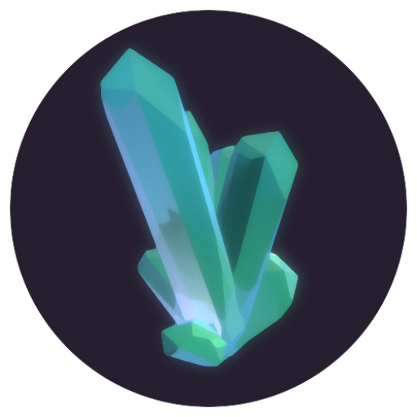

Development state: ~2%
One plugin renders 6 second spinning rectangle, everything hardoded.

# Build steps
```bash
git clone https://github.com/hupikus/vivianite
cd vivianite
./build.bash
```
Accept everything that's needed from build.sh and wait for the compilation.

# Run
Opening Vivianite at this state will bring you to an empty welcoming screen, because right now Vivianite is empty.  
But you can load the module as your rendering root by running it with arguments:
```
./vivianite --root modules/quick-render
```
